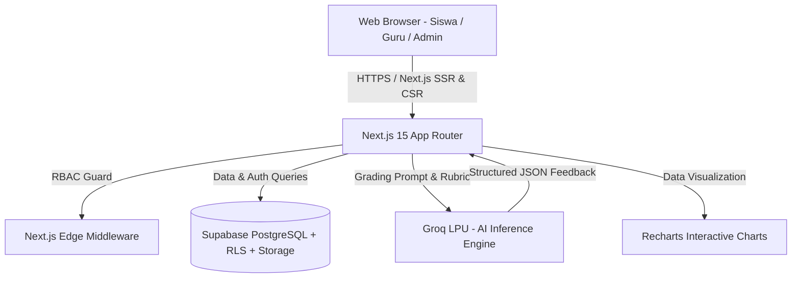
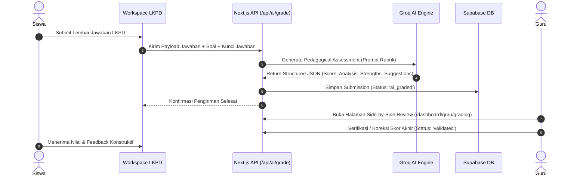

<div align="center">

# 🌱 Evolva E-Learning
### *Next-Generation Constructivist Learning Management System (LMS) for FMIPA*
Ditenagai oleh **Next.js 15 App Router**, **Groq AI (Llama 3.3 70B Versatile)**, **Supabase PostgreSQL**, dan **Tailwind CSS**.

[](https://nextjs.org/)
[](https://www.typescriptlang.org/)
[](https://tailwindcss.com/)
[](https://supabase.com/)
[](https://groq.com/)
[](https://katex.org/)

<p align="center">
  <a href="#-tentang-evolva">Tentang</a> •
  <a href="#-fitur-utama-berdasarkan-rubrik">Fitur Utama</a> •
  <a href="#-arsitektur--tech-stack">Tech Stack</a> •
  <a href="#-alur-kerja-pedagogis-ai">Alur AI</a> •
  <a href="#-panduan-instalasi--setup">Instalasi</a> •
  <a href="#-struktur-direktori">Struktur</a> •
  <a href="#-kontributor--lisensi">Lisensi</a>
</p>

---

</div>

## 📖 Tentang Evolva

**Evolva E-Learning** adalah platform pembelajaran daring modern berbasis pendekatan **konstruktivisme** yang dirancang khusus untuk memenuhi standar kurikulum akademik **Fakultas Matematika dan Ilmu Pengetahuan Alam (FMIPA)**. 

Platform ini memfasilitasi siklus pembelajaran aktif:
1. **Eksplorasi Mandiri**: Mahasiswa mempelajari materi ilmiah interaktif berstandar akademik tinggi lengkap dengan formulasi matematis dan notasi sains (**LaTeX/KaTeX**).
2. **Lembar Kerja Peserta Didik (LKPD)**: Workspace pengerjaan sekuensial terintegrasi yang mencegah distraksi navigasi dan melatih pemikiran analitis.
3. **Asesmen Cerdas Berbasis AI**: Evaluasi otomatis berbasis rubrik kriteria pedagogis menggunakan model **Llama 3.3 70B** via **Groq LPU Inference Engine**, memberikan *feedback* formatif instan dengan rincian skor, poin kekuatan, kelemahan, dan saran perbaikan.
4. **Validasi Pendidik (*Human-in-the-Loop*)**: Dosen/Guru memiliki kontrol penuh melalui antarmuka *side-by-side* untuk meninjau, mengesampingkan (override), atau menyetujui penilaian AI sebelum disahkan.

---

## 🎯 Fitur Utama (Berdasarkan Rubrik Penilaian Produk)

Platform dirancang memenuhi 100% kriteria **Rubrik Penilaian Produk E-Learning FMIPA**:

### 👑 1. Modul Admin (Bobot: 15 Poin)
- **A1. Manajemen Pengguna (CRUD & Realtime Status)**:
  - Pembuatan akun terpadu untuk Dosen/Guru, Mahasiswa/Siswa, dan Administrator.
  - Sakelar aktivasi akun instan (*Toggle Active/Inactive*) untuk proteksi akses akun.
- **A2. Manajemen Kelas & Rombel**:
  - Pembuatan kelas mata kuliah/pelajaran dengan kode kelas unik.
  - Alokasi guru pengampu dan pendaftaran anggota kelas (*enrollment*).
- **A3. Role-Based Access Control (RBAC)**:
  - Proteksi rute tingkat kernel via Next.js Middleware.
  - Isolasi data berlapis dengan **PostgreSQL Row Level Security (RLS)** pada Supabase.

### 🔬 2. Modul Guru / Dosen (Bobot: 50 Poin)
- **G1. Manajemen Materi & Silabus**:
  - Modul penyusunan materi komprehensif dengan kontrol ketersediaan (*draft* / *published*), upload dan edit materi pembelajaran.
- **G2. Studio LKPD & Soal Ilmiah**:
  - Editor soal multitipe (Esai analitis, Isian singkat, Pilihan ganda).
  - Integrasi sintaks **LaTeX** (`$...$`, `$$...$$`) untuk persamaan kalkulus, fisika teoretis, dan formula reaksi kimia.
  - Rubrik pedoman penilaian terstruktur per butir pertanyaan.
- **G3. Koreksi AI Otomatis (Groq AI)**:
  - Ditenagai Groq Cloud Inference Engine berkecepatan ultra-tinggi (<2 detik).
  - Evaluasi multi-dimensi: Skor numerik objektif berdasarkan rubrik, umpan balik konstruktivis Bahasa Indonesia, identifikasi kekuatan konsep (*strengths*), area perbaikan (*improvements*), dan penilaian terperinci per butir soal.
- **G4. Dasbor Penilaian Berdampingan (*Side-by-Side Review*)**:
  - Kolom kiri: Lembar respon asli mahasiswa + rubrik pedoman.
  - Kolom kanan: Hasil analisis Groq AI, badge skor per soal, serta form validasi nilai final dan catatan dosen.
- **G5. Analitik Kelas & Pusat Informasi**:
  - Visualisasi grafik interaktif berbasis **Recharts**:
    - **Grafik Batang (BarChart)**: Perbandingan Skor AI vs Nilai Validasi Dosen.
    - **Grafik Donat (PieChart)**: Proporsi status penyelesaian (Tervalidasi, Selesai AI, Menunggu).
    - **Tabel Rekapitulasi**: Daftar tugas masuk, status, dan akses cepat ke penilaian.
  - Manajemen anggota kelas (*Student Picker & Manage Students Modal*).
  - Papan pengumuman interaktif kelas.

### 🎓 3. Modul Siswa / Mahasiswa (Bobot: 20 Poin)
- **S1. Portal Kelas Interaktif**:
  - Akses cepat jadwal kelas terdaftar, modul pembelajaran, progres pengerjaan, dan tugas aktif.
- **S2. Workspace LKPD Fokus**:
  - Desain antarmuka *single-surface* bebas distraksi: materi rujukan dan lembar respon berada dalam satu alur kerja harmonis.
- **S3. Umpan Balik Cepat & Transparansi Nilai**:
  - Publikasi nilai terverifikasi beserta catatan konstruktif dari dosen dan evaluasi AI untuk pembelajaran berulang.

### 💎 4. Aspek Visual & Performa (Bobot: 15 Poin)
- **P1. Identitas Visual Premium FMIPA**:
  - Tipografi modern **Plus Jakarta Sans** untuk kenyamanan membaca teks panjang dan **JetBrains Mono** untuk ekspresi matematis/kode.
  - Palet warna harmonis berstandar rasio kontras WCAG 2.1 AA (*Emerald Green, Teal AI Accent, Slate Navy, Clean Neutral White*).
- **P2. Navigasi & Ergonomi**:
  - *Breadcrumbs* hierarkis di setiap subhalaman.
  - Navigasi sekuensial responsif untuk perangkat desktop, tablet, maupun seluler.
- **P3. Performa Ekstrem**:
  - Next.js Server Components (RSC) untuk latensi awal minimal dan skor Web Vitals optimal.

---

## 🛠️ Arsitektur & Tech Stack



| Layer | Teknologi | Peran & Alasan Pemilihan |
| :--- | :--- | :--- |
| **Framework** | **Next.js 15** | Server-Side Rendering (SSR), Server Actions, App Router terbaru |
| **Language** | **TypeScript 5** | *Type safety* penuh dari skema database hingga komponen UI |
| **Styling** | **Tailwind CSS** | Desain responsif berstandar industri dengan palet warna terkurasi |
| **Database & Auth** | **Supabase (PostgreSQL)** | *Managed PostgreSQL*, enkripsi data, Row Level Security (RLS) |
| **AI Engine** | **Groq Cloud** | Kecepatan inferensi ultra-tinggi untuk koreksi esai otomatis berakurasi tinggi |
| **Visualisasi Data** | **Recharts** | Grafik batang dan donat interaktif untuk dashboard analitik |
| **Icons & Math** | **Lucide Icons & KaTeX** | Desain ikon minimalis modern dan rendering formula matematika cepat |

---

## 🔄 Alur Kerja Pedagogis AI



---

## 📁 Struktur Direktori

```text
evolva-elearning/
├── public/                 # Aset statis, favicon, & logo
├── src/
│   ├── app/
│   │   ├── api/            # Server Route Handlers
│   │   │   ├── admin/      # API manajemen pengguna & role
│   │   │   ├── ai/grade/   # Endpoint integrasi Groq AI grading
│   │   │   ├── classes/    # API manajemen kelas & rombel
│   │   │   ├── guru/       # API penilaian & validasi skor guru
│   │   │   ├── lkpd/       # API operasi LKPD & soal
│   │   │   ├── materials/  # API materi pembelajaran
│   │   │   └── students/   # API daftar mahasiswa/siswa
│   │   ├── dashboard/      # Portal aplikasi terlindungi RBAC
│   │   │   ├── admin/      # Dashboard modul Administrator (A1-A3)
│   │   │   ├── guru/       # Dashboard modul Dosen/Guru (G1-G5)
│   │   │   │   ├── analytics/      # Visualisasi analitik pembelajaran
│   │   │   │   ├── announcements/  # Pusat pengumuman guru
│   │   │   │   ├── classes/        # Manajemen kelas & rombel
│   │   │   │   ├── grading/        # Side-by-side koreksi AI & validasi
│   │   │   │   ├── lkpd/           # Studio pembuatan LKPD
│   │   │   │   └── materials/      # Manajemen materi ajar
│   │   │   └── siswa/      # Dashboard modul Mahasiswa/Siswa (S1-S3)
│   │   ├── login/          # Antarmuka otentikasi login
│   │   ├── globals.css     # CSS Global & utilitas tema
│   │   ├── layout.tsx      # Root layout aplikasi
│   │   └── page.tsx        # Landing page publik Evolva
│   ├── components/
│   │   ├── analytics/      # Komponen visualisasi grafik Recharts
│   │   ├── classes/        # Modal & picker pemilihan siswa kelas
│   │   └── layout/         # Komponen arsitektur: Sidebar & TopNav
│   ├── lib/
│   │   ├── groq/           # Klien SDK Groq Cloud & prompt pedagogis
│   │   └── supabase/       # Klien Supabase (Client, Server, & Admin Client)
│   ├── middleware.ts       # Next.js Middleware proteksi rute RBAC
│   └── types/              # Definisi interface TypeScript
└── supabase/
    └── schema.sql          # Skema database PostgreSQL DDL + RLS Policies
```

---

## 🚀 Panduan Instalasi & Setup

### 1. Prasyarat Sistem
- **Node.js**: v18.18.0 atau versi yang lebih baru
- **NPM / PNPM / Yarn**
- Akun layanan **[Supabase](https://supabase.com/)**
- Akun layanan **[Groq Cloud](https://console.groq.com/)**

### 2. Kloning Repositori
```bash
git clone https://github.com/kakaadsp/evolva-elearning.git
cd evolva-elearning
```

### 3. Instalasi Dependensi
```bash
npm install
```

### 4. Konfigurasi Environment (`.env.local`)
Buat berkas `.env.local` pada direktori *root* proyek:
```env
# Supabase Configuration
NEXT_PUBLIC_SUPABASE_URL=https://your-project.supabase.co
NEXT_PUBLIC_SUPABASE_ANON_KEY=eyJhbGciOiJIUzI1NiIsInR5cCI6IkpXVCJ9...
SUPABASE_SERVICE_ROLE_KEY=eyJhbGciOiJIUzI1NiIsInR5cCI6IkpXVCJ9...

# Groq AI Configuration
GROQ_API_KEY=gsk_your_groq_api_key_here
```

### 5. Setup Database Supabase
1. Masuk ke **[Supabase Dashboard](https://app.supabase.com/)** dan buat proyek baru.
2. Navigasikan ke menu **SQL Editor**.
3. Buka berkas [`supabase/schema.sql`](./supabase/schema.sql), salin seluruh kueri DDL, lalu klik tombol **Run**.
4. Skema akan menginisialisasi 7 tabel relasional utama, relasi *Foreign Key*, *Triggers*, dan kebijakan keamanan **RLS (Row Level Security)**.

### 6. Menjalankan Server Lokal
```bash
npm run dev
```
Akses aplikasi melalui browser di **`http://localhost:3000`**.

---

## 🚢 Panduan Deployment (Vercel)

Proyek ini telah dikonfigurasi optimal untuk penyebaran di platform **Vercel**:

1. Unggah kode ke repositori GitHub.
2. Masuk ke **[Vercel Dashboard](https://vercel.com/)** dan pilih **Add New Project** → Import repositori `evolva-elearning`.
3. Pada bagian **Environment Variables**, daftarkan:
   - `NEXT_PUBLIC_SUPABASE_URL`
   - `NEXT_PUBLIC_SUPABASE_ANON_KEY`
   - `SUPABASE_SERVICE_ROLE_KEY`
   - `GROQ_API_KEY`
4. Klik **Deploy**. Aplikasi akan otomatis di-build dan siap digunakan secara publik.

---

## 📄 Kontributor & Lisensi

Dikembangkan dengan dedikasi untuk kemajuan ekosistem pendidikan FMIPA.

- **Pengembang**: Tim Evolva E-Learning ([@kakaadsp](https://github.com/kakaadsp))
- **Lisensi**: Proyek ini dirilis di bawah lisensi [MIT License](LICENSE).

<div align="center">

**🌱 Evolva E-Learning · Empowering Mind, Elevating Science**

</div>
